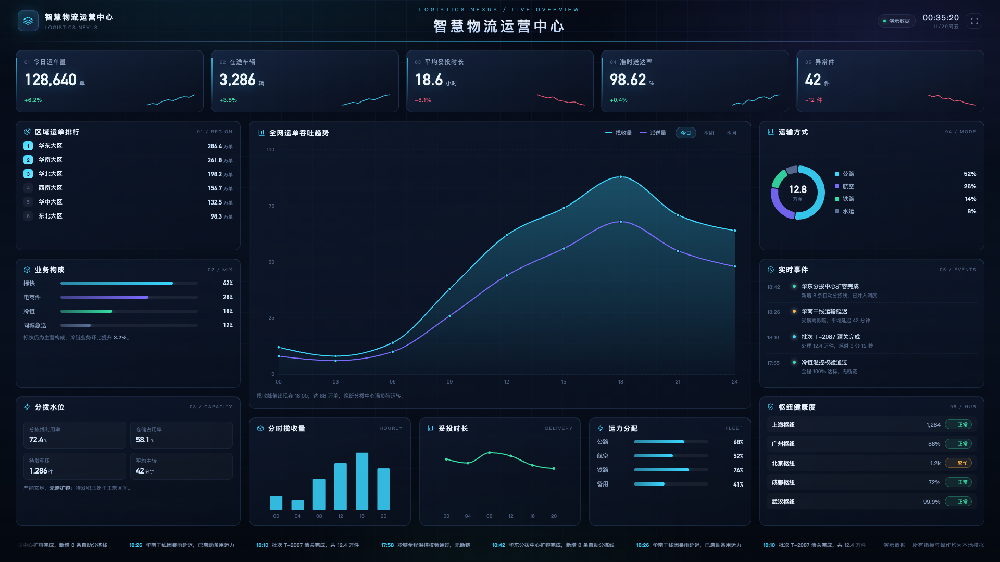
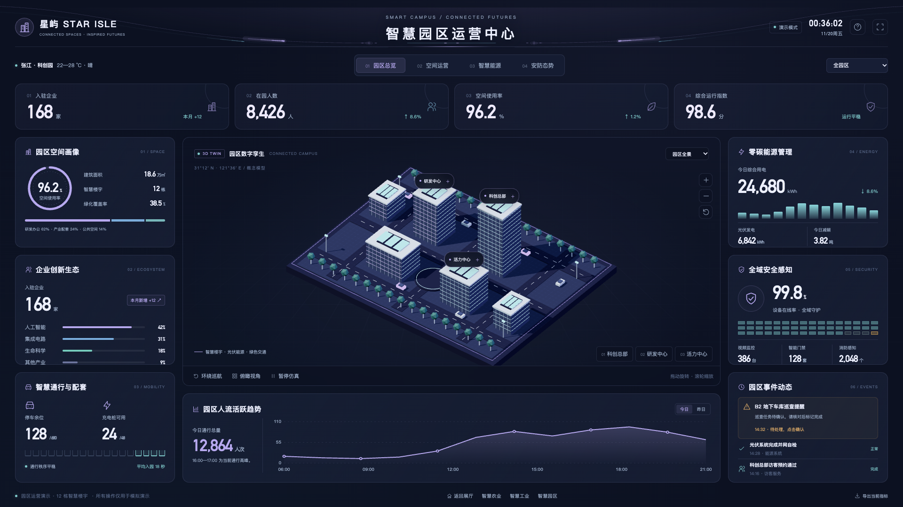
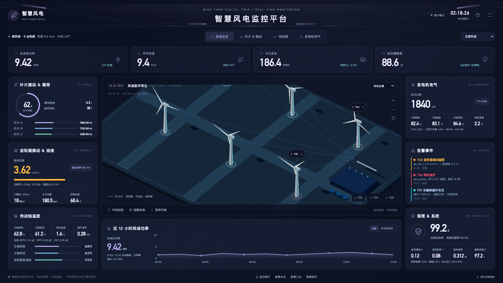
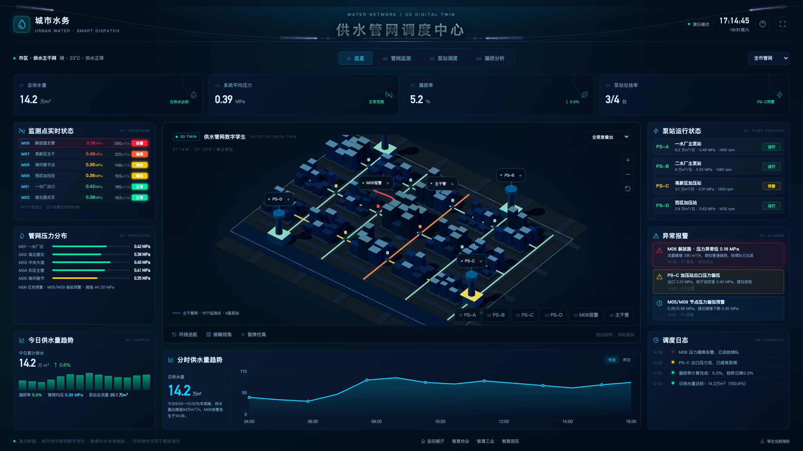
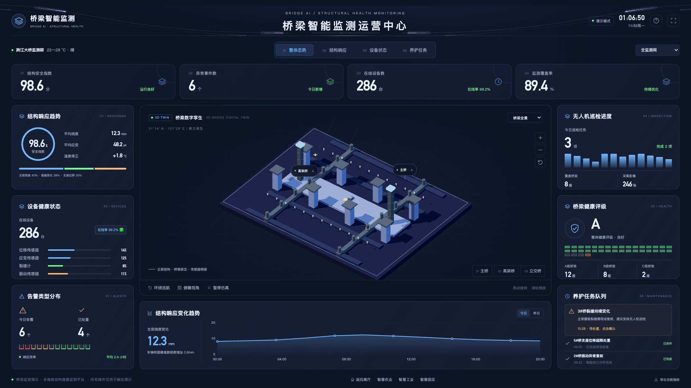
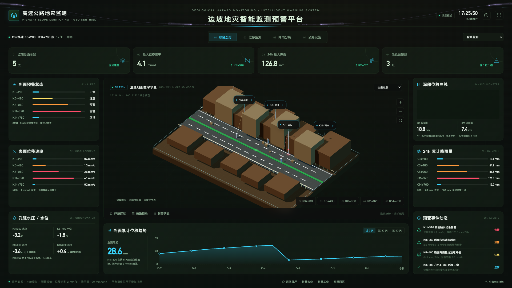
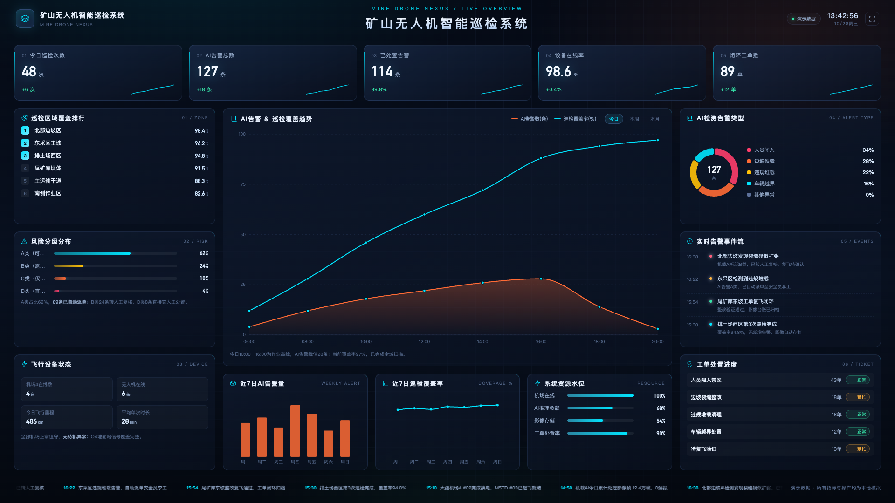
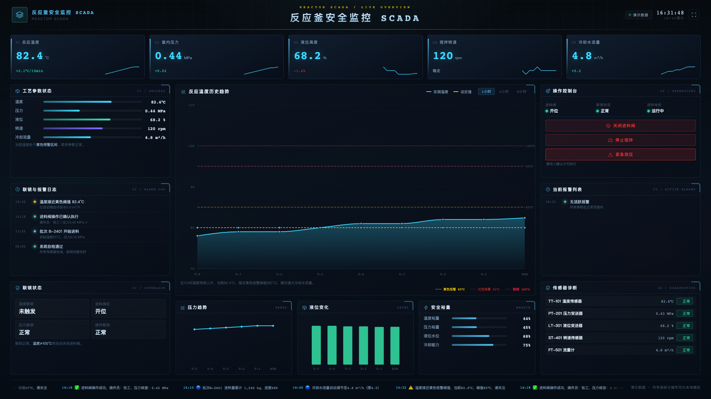
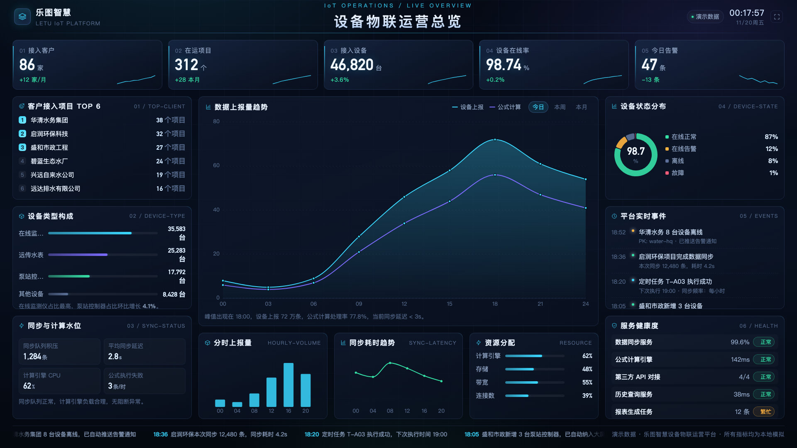

# skill-bigscreen-studio

对话式生成通用/商业可视化大屏的 AI Skill。用户描述业务主题，Skill 引导 AI 完成"脚手架 → 写数据与场景 → 构建 → 截图自检 → 输出"，产出可双击离线打开的 1920×1080 单文件 HTML。

适用于销售、运营、物流、政务、园区、港口等以"看数据"为主的场景，不含设备控制和操作防误。需要 SCADA/HMI 一类工业控制界面时，请使用姊妹仓库 [skill-industrial-screen](https://github.com/alinkiot/skill-industrial-screen)。

## 预设

| 预设 | 形态 | 适用 |
| --- | --- | --- |
| `flat` | 纯数据看板：KPI、主趋势、排行/占比/事件、三小图，无 WebGL | 销售、运营、物流、金融、政务等，默认选它 |
| `observatory` | 3D 数字孪生：Three.js 场景、运营面板、场景点选 | 园区、工厂、港口、机场、电站、矿山等有物理空间的题材 |

## 目录结构

```text
SKILL.md          Skill 入口（触发条件、五步工作流、硬规矩）
references/       引擎契约、flat/observatory API、设计系统、行业 playbook
scripts/          engine / prepare / scaffold / verify
assets/flat/      flat 预设模板
out/              示例产物与每次构建的输出目录
preview.webp      预览图
```

## 依赖

- Node.js 18+
- Python 3.10+（含 Pillow），用于引擎构建
- Playwright，用于截图自检（缺失时仍能产出 HTML，只是没有截图和自检）
- 渲染引擎 [screen-picture-demo](https://github.com/zhengweixing/screen-picture-demo)，解析优先级如下：
  1. `--engine` 参数或环境变量 `VIZLAB_ENGINE`
  2. 本地引擎自动探测（取第一个含 `config/screens.json` + `scripts/build.py` 的目录）：`<skill>/../vizlab` → `<skill>/../../big-screen/vizlab` → `<skill>/../../../vizlab`
  3. `~/.bigscreen-ai/cache/bigscreen-engine`，不存在时自动 `git clone` 并安装依赖
  - 用 `node scripts/engine.mjs` 可查看当前实际解析路径。

## 安装

将本仓库放到 AI 工具的 skills 目录下，目录名使用 `bigscreen-studio`，或打包为 zip 上传：

```bash
git clone git@github.com:alinkiot/skill-bigscreen-studio.git bigscreen-studio
```

## 用法

```bash
# 1. 脚手架（自动准备引擎）
node scripts/scaffold.mjs --id port-ops --preset observatory \
  --title "智慧港口运营中心" --label "PORT NEXUS" \
  --desc "连接泊位、船舶与作业设备，让港口吞吐一目了然。" \
  --category operations --tags "港口,泊位调度,数字孪生"

# 2. 修改引擎 src/screens/<id>/ 下的数据与场景（flat 改 app.js 的 DATA）

# 3. 构建 + 截图自检 + 出包
node scripts/verify.mjs --id port-ops

# 可选：预热引擎
node scripts/prepare.mjs
```

常用开关：`--update` 拉取引擎最新代码，`--out <dir>` 改输出目录，`--no-build`、`--keep-build`、`--bake-preview` 见 `references/engine.md`。

## 产物（`out/`）

```text
out/<id>/<id>.html          单文件大屏，依赖全内联，离线可打开
out/<id>/<id>-1920.png      1920×1080 截图
out/<id>/<id>-report.json   自检结论（ok / errors / warnings / audit.overflow）
```

交付标准是 `ok: true` 且 `audit.overflow` 为空。数据均为演示数据，页脚会标注"演示数据 · 本地模拟"，替换 `app.js` 中的 `DATA` 即可接入真实接口。

## 示例与效果展示

以下两个大屏由本 skill 的 `scaffold → 写内容 → verify` 完整流程生成，均 `ok: true`、无控制台报错。每个示例给出可直接使用的提示词与 1920×1080 实拍效果图。

### 示例一 · 智慧物流运营中心（flat）

提示词（直接对 AI 说）：

> 做一个智慧物流运营中心的数据大屏。指标看今日运单量、在途车辆、平均妥投时长、准时送达率、异常件；主图是运单吞吐趋势，能切今日/本周/本月；左边放区域运单排行、业务构成、分拨水位，右边放运输方式占比、实时事件、枢纽健康度；底部三个小图看分时揽收、妥投时长、运力分配。演示数据。

AI 判断为 `flat` 预设（纯看数据、无物理场景），脚手架后只需改 `app.js` 的 `DATA`，生成 `out/ops-test-dashboard/`。



效果展示：五个 KPI 卡（带迷你 sparkline）；中部运单吞吐双线趋势 + 日/周/月周期切换；左右各三块面板（排行/占比/事实、环形图/时间线/明细）；底部三个小图与滚动事件条。自检 `ok: true`，`audit.overflow` 为空。

### 示例二 · 智慧园区数字孪生（observatory）

提示词（直接对 AI 说）：

> 做一个智慧园区数字孪生大屏，要能看到园区的三维场景，可以点选建筑看详情，配运营面板展示园区态势。演示数据。

AI 判断为 `observatory` 预设（用户提到具体物理场地、希望"看到场景"），脚手架从 park 场景复制 3D 骨架，生成 `out/park-twin-test/`。



效果展示：Three.js 三维园区白模（建筑、道路、绿化）居中呈现，支持场景点选；左右运营面板展示园区指标与事件；WebGL 渲染正常（`audit.renderer=webgl`，约 29 draw calls）。自检 `ok: true`，有 1 个 3px 的轻微溢出告警，来自引擎 park 模板，不影响交付。

### 其余样例画廊

`out/` 另有一批既有大屏，全部自检 `ok: true`、`audit.overflow` 为空。同样附上提示词与效果图，便于对照选型（3D 类为 `observatory`，数据类为 `flat`）。

#### 智慧风电监控平台（wind-power · observatory）

提示词：

> 做一个智慧风电监控平台，能看到风场的三维场景和风机模型，配运营面板展示发电量、设备状态与告警。演示数据。



效果展示：三维风场与风机模型（WebGL 渲染，134 draw calls），右侧运营面板；自检 ok、无溢出。

#### 城市供水管网调度中心（water-network · observatory）

提示词：

> 做一个城市供水管网调度中心大屏，用三维场景展示管网与泵站，配调度面板展示压力、流量和漏损。演示数据。



效果展示：三维管网场景 + 调度面板，WebGL 渲染；自检 ok、无溢出。

#### 桥梁智能监测运营中心（bridge-monitoring · observatory）

提示词：

> 做一个桥梁智能监测运营中心大屏，三维桥梁场景，面板展示挠度、振动、索力等监测指标和预警。演示数据。



效果展示：三维桥梁模型 + 监测面板，WebGL 渲染；自检 ok、无溢出。

#### 边坡地灾智能监测预警平台（geo-hazard · observatory）

提示词：

> 做一个边坡地灾智能监测预警平台，三维边坡场景，展示位移、降雨量、裂缝等监测数据和预警等级。演示数据。



效果展示：三维边坡场景 + 监测预警面板，WebGL 渲染；自检 ok、无溢出。

#### 矿山无人机智能巡检系统（mine-drone · flat）

提示词：

> 做一个矿山无人机智能巡检系统大屏，展示巡检航线、识别到的隐患、设备状态和告警统计。演示数据，纯数据看板。



效果展示：KPI + 巡检趋势 + 隐患与设备面板，无 WebGL；自检 ok、无溢出。

#### 反应釜安全监控 SCADA（reactor-scada · flat）

提示词：

> 做一个反应釜安全监控大屏，展示温度、压力、液位趋势和安全联锁状态，纯数据展示。演示数据。



效果展示：反应釜关键参数与趋势面板，无 WebGL；自检 ok、无溢出。

#### 乐图智慧设备物联运营总览（letu-ops · flat）

提示词：

> 做一个设备物联运营总览大屏，展示接入客户、在途项目、接入设备数和在线率，配上报量趋势、设备类型构成、资源分配和健康度面板。演示数据。



效果展示：五个 KPI + 上报量主趋势 + 客户排行/设备构成/同步水位 + 底部三小图与事件条；无 WebGL。

### 产物说明

由本 skill 现流程（`scaffold → verify`）生成的示例目录含三件套：`<id>.html`（单文件大屏）、`<id>-1920.png`（1920×1080 截图）、`<id>-report.json`（自检结论）。`verify.mjs` 会自动把报告里的 home 路径脱敏成 `~/...`（Windows/Linux 同样覆盖），可安全提交或贴文档。

`letu-ops` 是拆分前的早期产物，未注册进引擎、无法用现流程重建，因此没有 `-report.json`，仅保留 `<id>.html` + 截图。其余示例均为完整三件套。

引擎依赖只需准备一次：在解析到的本地引擎目录执行 `python3 -m venv .venv && .venv/bin/pip install -r requirements.txt`、`npm ci`、`npx playwright install chromium`；`scaffold` / `verify` 会在缺少依赖时自动补齐。用 `node scripts/engine.mjs` 可查看当前实际使用的引擎路径。

## 许可

与原 big-screen 工作区一致，见上游仓库 LICENSE。
